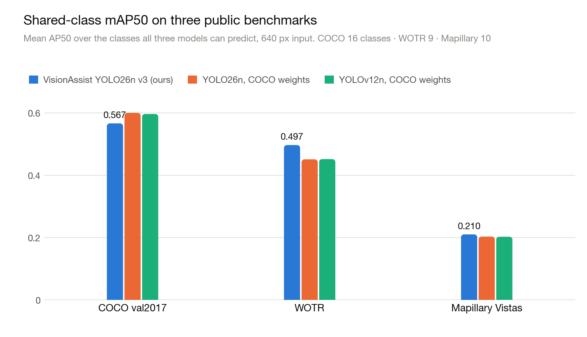
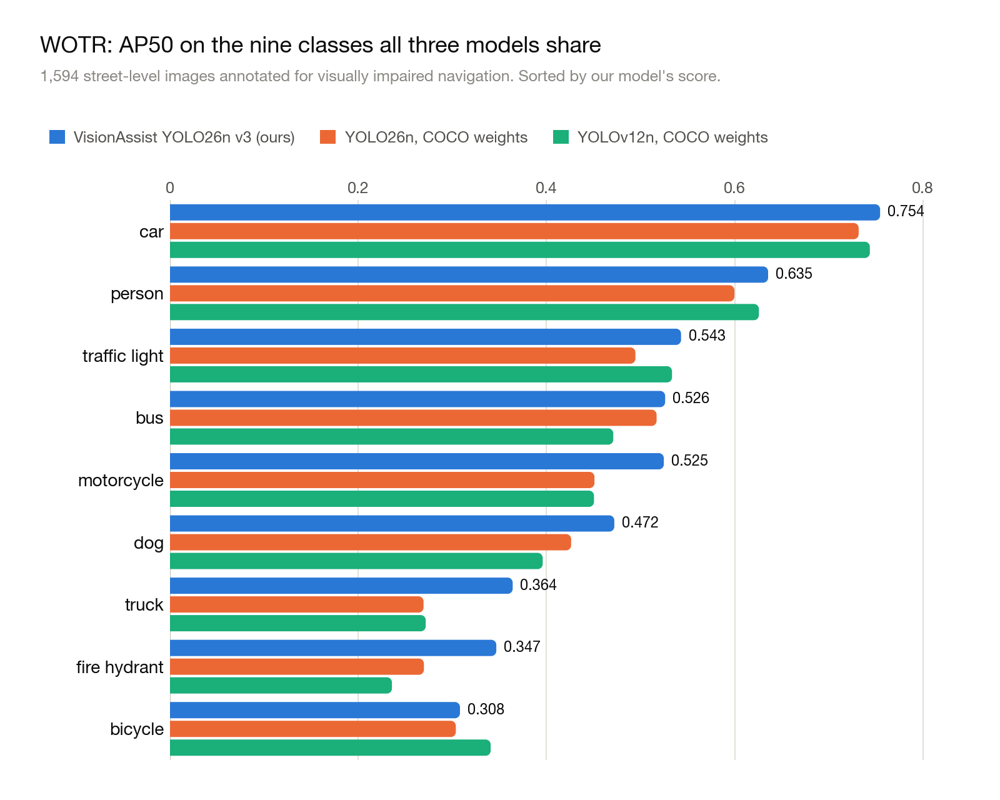
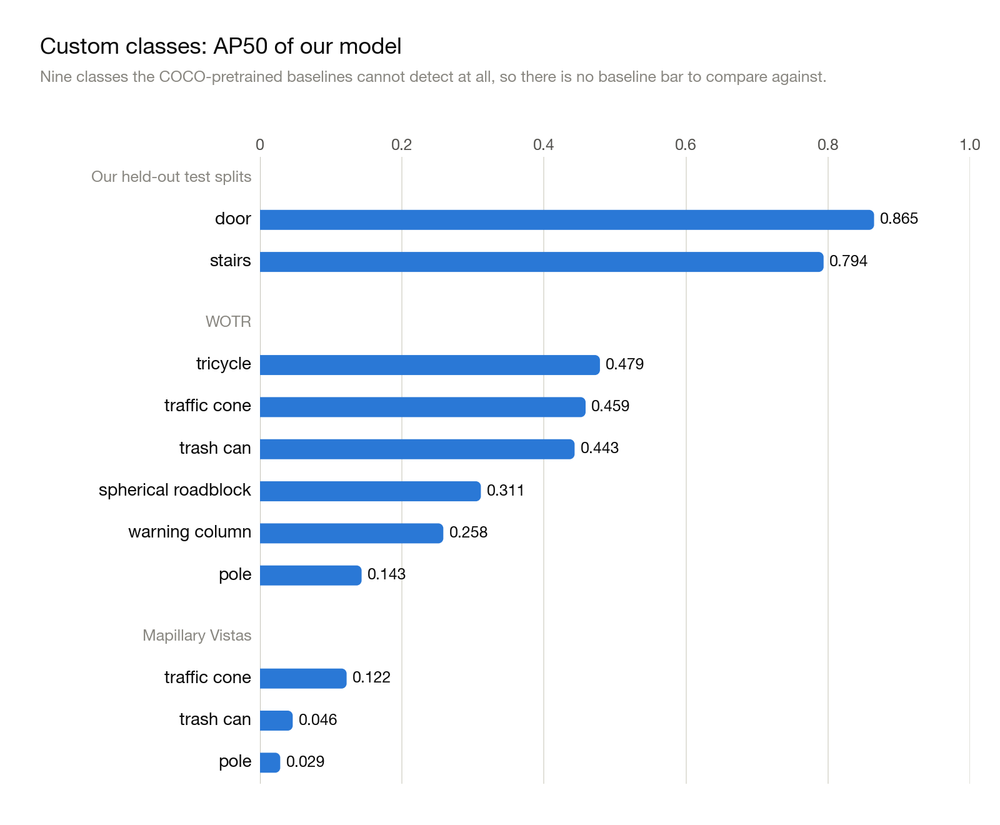
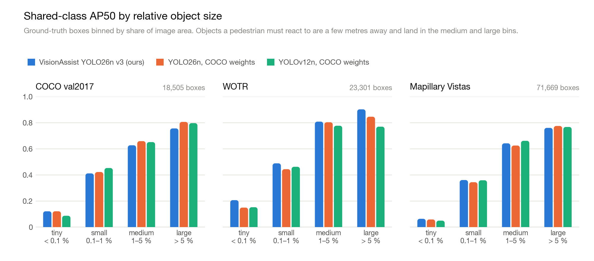

# LiDARVision: Real-Time YOLO + LiDAR Vision Assistance for iPhone

LiDARVision is an iOS research prototype that combines **on-device YOLO object detection** with **Apple iPhone depth sensing / LiDAR** to provide spatially aware assistance for people with visual impairments.

The app runs a **custom-trained YOLO26n detector (VisionAssist v3, 25 classes)** on the live camera feed, attaches an estimated distance to each detection using **ARKit scene depth**, overlays the results on screen, and speaks the nearest objects aloud. The detector was fine-tuned for sidewalk and street navigation: on top of 16 everyday COCO classes it recognizes nine obstacle classes that stock COCO models cannot see at all (potholes, stairs, traffic cones, trash cans, warning columns, spherical roadblocks, poles, tricycles, and doors). The whole network runs on the Apple Neural Engine, which keeps the phone cool enough for long walks.

## App Preview

<table>
  <tr>
    <td align="center" width="50%">
      
    </td>
    <td align="center" width="50%">
      
    </td>
  </tr>
  <tr>
    <td align="center"><strong>Live object detection with distance readout</strong></td>
    <td align="center"><strong>Depth-aware overlay for larger scene objects</strong></td>
  </tr>
</table>

## Project Goal

The goal of this project is to explore how modern mobile vision models and Apple depth hardware can work together to support **accessible real-time scene understanding**. In particular, the app aims to:

- detect everyday objects **and street obstacles** using a custom YOLO model running entirely on-device
- estimate how far detected objects are from the user using LiDAR / scene depth
- provide spoken feedback for the most relevant nearby detections
- stay usable for tens of minutes at a time without overheating or draining the battery
- create a foundation for assistive navigation and environmental awareness tools

## What the Code Does

The app implements the following pipeline:

1. **Starts an ARKit world-tracking session** using `ARWorldTrackingConfiguration`, choosing a moderate 30 fps video format (≥1280 px wide) rather than the maximum-resolution one, because the detector only ever sees 640×640 pixels and 4K capture is pure heat.
2. **Requests scene depth** when the device supports it (LiDAR on Pro models, stereo depth otherwise).
3. **Receives camera frames on a background queue** and copies out every Nth frame for detection. The cadence adapts to the thermal state: about 10 inferences per second while the phone is cool, 5 when iOS reports *fair*, 3 at *serious*, and under 2 at *critical*.
4. **Runs the Core ML model through Vision** on the Apple Neural Engine and decodes the raw `(1, 8400, 29)` output tensor in Swift (see [Detection Model](#detection-model)).
5. **Builds `Detection` objects** containing label, confidence, bounding box, and optional distance in meters.
6. **Stabilizes detections across frames** with a lightweight tracker to reduce flicker, then keeps the five closest objects.
7. **Displays the live camera feed** with bounding boxes and labels in SwiftUI, downscaling the preview to about 1080 px so the UI thread stays light.
8. **Announces nearby detections with speech** using `AVSpeechSynthesizer`, ordered by distance and throttled so the user is not flooded.

## Detection Model

| | |
|---|---|
| Architecture | YOLO26n (Ultralytics), 640×640 input, Core ML FP16 |
| Classes | 25: person, bicycle, car, motorcycle, bus, train, truck, traffic light, fire hydrant, stop sign, bench, dog, umbrella, suitcase, chair, potted plant, **pothole, stairs, traffic cone, trash can, warning column, spherical roadblock, pole, tricycle, door** |
| Training data | 62,181 train / 7,311 validation / 2,609 test images merged from eleven source datasets (a COCO train2017 subset plus public street-obstacle, stairs, pothole, pole, and door datasets), deduplicated across sources with exact and perceptual hashing so that no evaluation image has a near-duplicate in training |
| Internal validation | mAP50 0.641, mAP50-95 0.456 on the 7,311-image held-out split |
| Bundled file | `ObjectDetectionApp/ObjectDetectionApp/VisionAssistModel.mlpackage` (4.8 MB) |

**Why the model is exported without its decode head.** The standard end-to-end YOLO26 Core ML export ends with a few decoding operations (top-k and gather) that the Neural Engine does not support. Core ML then schedules the *entire* graph on the GPU, which ARKit also needs, and an iPhone 13 Pro hit thermal throttling within three minutes. The bundled model is the same trained weights with that decode head cut off: it outputs an `(1, 8400, 29)` tensor (8,400 candidate boxes, each with four corner coordinates in 640-pixel input space and 25 class scores), and `YOLODetector.swift` applies the confidence threshold in Swift. Because YOLO26 uses a one-to-one head, no non-maximum suppression is needed. The detections are bit-identical to the original export, 274 of the 276 operations run on the Neural Engine, and inference drops from about 60 ms to 8 ms.

## Benchmarks

We evaluated the model zero-shot on three public datasets it never trained on, against the official Ultralytics COCO checkpoints of **YOLO26n** and **YOLOv12n** (same size class). All three models run at 640 px, confidence 0.001, up to 300 detections per image, scored with the COCO protocol (pycocotools). Because our model has a different class list, each benchmark is split into **shared classes** (classes all three models can predict, compared head-to-head) and **custom classes** (classes only our model has). A leakage audit removed every benchmark image whose content matched our training pool (for example, 1,033 WOTR images that share provenance with one of our training sources, and 2 COCO val images). Door and stairs have no public benchmark, so they are scored on our own held-out test splits (112 and 721 images), checked by the same audit.

| Benchmark | What it is | Images | Shared / custom classes |
|---|---|---:|---|
| COCO val2017 | General object detection, indoor and outdoor | 4,998 | 16 / 0 |
| WOTR | Street-level images annotated for visually impaired navigation | 1,594 | 9 / 6 |
| Mapillary Vistas v2.0 | High-resolution street scenes from around the world, validation set | 2,000 | 10 / 3 |
| Door test split | Our own held-out door images | 112 | 0 / 1 |
| Stairs test split | Our own held-out stairs images | 721 | 0 / 1 |

Raw per-pair results, the chart script, and the benchmark notes live in [`docs/benchmarks/`](docs/benchmarks/).

### Shared classes: head-to-head

<picture>
  <source media="(prefers-color-scheme: dark)" srcset="docs/benchmarks/shared_map50_dark.png">
  
</picture>

| Benchmark | Images | Shared classes | Ours mAP50 / mAP50-95 | YOLO26n | YOLOv12n |
|---|---:|---:|---:|---:|---:|
| COCO val2017 | 4,998 | 16 | 0.567 / 0.379 | **0.601 / 0.434** | 0.597 / 0.434 |
| WOTR | 1,594 | 9 | **0.497 / 0.295** | 0.451 / 0.278 | 0.452 / 0.274 |
| Mapillary Vistas | 2,000 | 10 | **0.210 / 0.123** | 0.203 / 0.120 | 0.203 / 0.123 |

On the street benchmark that matches the app's use case (WOTR) our model leads both baselines by 4.5 mAP50 points and wins on eight of the nine shared classes. On Mapillary the three models are essentially tied. On COCO we give up about 3 points, which is the cost of specializing a nano-sized model toward street scenes and nine extra classes.

### Per-class results on WOTR

<picture>
  <source media="(prefers-color-scheme: dark)" srcset="docs/benchmarks/wotr_shared_classes_dark.png">
  
</picture>

The largest gains are on truck, fire hydrant, and motorcycle, exactly the classes where extra street exposure during training should help.

<details>
<summary>Table: AP50 per shared class on WOTR</summary>

| Class | Ours | YOLO26n | YOLOv12n |
|---|---:|---:|---:|
| car | **0.754** | 0.732 | 0.744 |
| person | **0.635** | 0.600 | 0.626 |
| traffic light | **0.543** | 0.494 | 0.533 |
| bus | **0.526** | 0.517 | 0.471 |
| motorcycle | **0.525** | 0.451 | 0.451 |
| dog | **0.472** | 0.426 | 0.396 |
| truck | **0.364** | 0.269 | 0.272 |
| fire hydrant | **0.347** | 0.270 | 0.236 |
| bicycle | 0.308 | 0.304 | **0.341** |

</details>

### Custom classes: capability the baselines do not have

<picture>
  <source media="(prefers-color-scheme: dark)" srcset="docs/benchmarks/custom_classes_dark.png">
  
</picture>

The baselines have no output for these classes, so there is nothing to compare against; these rows describe added capability. The precision and recall columns are measured at the app's actual operating point (confidence 0.25, IoU 0.5). Precision is high for the classes the app announces most, which means false alarms are rare; recall is limited mostly by tiny, distant instances that the app does not need to react to (see the next section).

| Benchmark | Class | AP50 | AP50-95 | Precision @0.25 | Recall @0.25 |
|---|---|---:|---:|---:|---:|
| Our door test split | door | 0.865 | 0.679 | 0.84 | 0.78 |
| Our stairs test split | stairs | 0.794 | 0.493 | 0.79 | 0.73 |
| WOTR | tricycle | 0.479 | 0.363 | 0.95 | 0.35 |
| WOTR | traffic cone | 0.459 | 0.270 | 0.90 | 0.32 |
| WOTR | trash can | 0.443 | 0.303 | 0.90 | 0.26 |
| WOTR | spherical roadblock | 0.311 | 0.201 | 0.93 | 0.24 |
| WOTR | warning column | 0.258 | 0.077 | 0.77 | 0.13 |
| WOTR | pole | 0.143 | 0.036 | 0.64 | 0.03 |
| WOTR | *mean of 6* | *0.349* | *0.208* | | |
| Mapillary Vistas | traffic cone | 0.122 | 0.060 | 0.93 | 0.02 |
| Mapillary Vistas | trash can | 0.046 | 0.027 | 0.00 | 0.00 |
| Mapillary Vistas | pole | 0.029 | 0.011 | 0.58 | 0.01 |
| Mapillary Vistas | *mean of 3* | *0.066* | *0.033* | | |

Two caveats. WOTR labels every distant pole (5,339 instances), far stricter than our training convention, so pole recall reads low there. Mapillary images are roughly 8-megapixel panoramas: 65% of its boxes cover less than 0.1% of the frame, about 18 px across once the image is resized to 640, so every model scores low on it and no trash can was detected above confidence 0.25.

### Results by object size

<picture>
  <source media="(prefers-color-scheme: dark)" srcset="docs/benchmarks/size_bins_dark.png">
  
</picture>

Headline mAP averages over every ground-truth box, and most boxes in street datasets are tiny background instances (84% of WOTR boxes and 91% of Mapillary boxes cover less than 1% of the frame). The obstacles a pedestrian must react to are a few meters away and fall in the medium (1–5% of the frame) and large (>5%) bins. In those bins our model scores 0.81 and 0.90 AP50 on WOTR against 0.80/0.85 (YOLO26n) and 0.78/0.77 (YOLOv12n), and on Mapillary it is within noise of both baselines. The COCO gap is present in every bin, so it is a real but modest cost rather than a size artifact.

<details>
<summary>Tables: shared-class AP50 per size bin</summary>

**COCO val2017** — ground-truth boxes per bin: tiny 2,442, small 6,244, medium 4,662, large 5,157, all 18,505

| Model | tiny <0.1% | small 0.1–1% | medium 1–5% | large >5% | all |
|---|---:|---:|---:|---:|---:|
| Ours (YOLO26n v3) | 0.121 | 0.411 | 0.627 | 0.756 | 0.567 |
| YOLO26n | 0.121 | 0.422 | 0.658 | 0.806 | 0.601 |
| YOLOv12n | 0.087 | 0.453 | 0.651 | 0.796 | 0.597 |

**WOTR** — ground-truth boxes per bin: tiny 6,854, small 12,889, medium 2,637, large 921, all 23,301

| Model | tiny <0.1% | small 0.1–1% | medium 1–5% | large >5% | all |
|---|---:|---:|---:|---:|---:|
| Ours (YOLO26n v3) | 0.206 | 0.488 | 0.808 | 0.902 | 0.497 |
| YOLO26n | 0.149 | 0.444 | 0.803 | 0.846 | 0.451 |
| YOLOv12n | 0.152 | 0.462 | 0.777 | 0.769 | 0.452 |

**Mapillary Vistas** — ground-truth boxes per bin: tiny 46,810, small 18,763, medium 4,811, large 1,285, all 71,669

| Model | tiny <0.1% | small 0.1–1% | medium 1–5% | large >5% | all |
|---|---:|---:|---:|---:|---:|
| Ours (YOLO26n v3) | 0.063 | 0.360 | 0.642 | 0.760 | 0.210 |
| YOLO26n | 0.058 | 0.344 | 0.625 | 0.775 | 0.203 |
| YOLOv12n | 0.049 | 0.359 | 0.661 | 0.767 | 0.203 |

</details>

## On-Device Performance

Measured with an instrumented build of this app on an **iPhone 13 Pro** during a 43-minute continuous outdoor outing (15,280 inferences). The instrumentation is documented in [`ObjectDetectionApp/PERFLOG.md`](ObjectDetectionApp/PERFLOG.md) and summarized by [`ObjectDetectionApp/analyze_perflog.py`](ObjectDetectionApp/analyze_perflog.py).

| Metric | Measured |
|---|---|
| Model inference (Neural Engine) | 8.4 ms median; 5.8 ms while *nominal*, 8.9 ms *fair*, 12.1 ms *serious* |
| Same model, GPU-resident export | ~60 ms, thermal throttling within three minutes |
| Swift decode of the 8,400-anchor tensor | 43 ms median (now the largest term) |
| End-to-end, frame capture to results | 110 ms median, under 140 ms for 99% of frames |
| Frame capture to spoken announcement | 116 ms median |
| Camera delivery | 30 fps throughout |
| Detection rate | ~10 Hz while *nominal*, 5 Hz *fair*, 3 Hz *serious* (thermal-adaptive) |
| Thermal state over the outing | 21% *nominal*, 77% *fair*, 2% *serious*, never *critical* |
| Memory | 184 MB average, 308 MB peak |
| Model load | ~90 ms (one-time 1.3 s compile on first launch) |
| Battery | 35% per hour with the screen and all sensors active |
| LiDAR-fused depth | available on 75% of processed frames, camera-only fallback otherwise |

Distance readouts were checked against a laser distance meter at 3 to 12 ft for six object classes and matched to within centimeters.

## Key Features

- **On-device object detection** with a custom 25-class YOLO26n Core ML model, Neural Engine resident
- **Nine street-obstacle classes** that COCO-pretrained models do not have
- **Depth-aware distance estimation** using ARKit scene depth and LiDAR-capable devices
- **Real-time camera overlay** with bounding boxes, class labels, confidence, and distance
- **Audio feedback** for nearby objects, ordered by proximity
- **Detection smoothing / temporal stabilization** to improve usability
- **Thermal-aware processing**: moderate capture format, frame skipping that backs off as the phone warms, downscaled preview, reusable pixel buffers and Vision requests
- **Fallback behavior** on devices without LiDAR, with the UI indicating whether LiDAR or stereo depth is being used

## Main Components

### `ContentView.swift`
Handles the camera permission flow, presents the live camera interface, and stops/restarts the AR session when the app goes to the background and returns.

### `CameraManager.swift`
This is the core runtime controller. It:
- configures and runs the AR session on a background delegate queue
- checks for LiDAR / scene depth availability
- picks the detection cadence from the current thermal state
- manages capture, detection, rendering, and speech timing
- keeps the closest few detections active

### `YOLODetector.swift`
Loads `VisionAssistModel` with `computeUnits = .all`, keeps one reusable `VNCoreMLRequest`, and decodes the raw output tensor into `Detection` values using the 25-entry label list (whose order must match the training `data.yaml`).

### `Detection.swift`
Defines the app's detection model, including label, confidence, bounding box, and optional distance in meters.

### `DetectionTracker.swift`
Adds temporal smoothing to reduce noisy bounding boxes and short-lived flicker between frames.

### `DetectionSpeechManager.swift`
Generates spoken summaries such as object names and distances so the app can provide accessible feedback.

### `CameraView.swift`
Displays the camera image and draws detection overlays in SwiftUI.

### `Logging/PerfLogger.swift` and `Views/LogExportView.swift`
The performance instrumentation used to collect the numbers above (append-only JSON Lines log, exportable from the app). These two files are kept in the repository for reproducibility but are **not** part of the Xcode target in the shipping build; `PERFLOG.md` explains how to re-enable them.

## Repository Structure

```text
ObjectDetectionApp/
├── ObjectDetectionApp/
│   ├── Camera/
│   │   └── CameraManager.swift
│   ├── Detection/
│   │   ├── Detection.swift
│   │   ├── DetectionSpeechManager.swift
│   │   ├── DetectionTracker.swift
│   │   └── YOLODetector.swift
│   ├── Logging/
│   │   └── PerfLogger.swift          (not in the target; see PERFLOG.md)
│   ├── Views/
│   │   ├── CameraView.swift
│   │   └── LogExportView.swift       (not in the target; see PERFLOG.md)
│   ├── VisionAssistModel.mlpackage   (YOLO26n v3, 25 classes, ANE-friendly export)
│   ├── ContentView.swift
│   ├── Info.plist
│   └── ObjectDetectionAppApp.swift
├── ObjectDetectionApp.xcodeproj/
├── PERFLOG.md                        (performance-log format and analysis notes)
└── analyze_perflog.py                (stdlib script that summarizes the logs)
docs/benchmarks/                      (charts, chart script, raw benchmark results)
```

## Requirements

- iPhone running iOS 17 or later (the app uses the two-parameter `onChange(of:)` API)
- Best experience on a **LiDAR-capable iPhone Pro**; the Neural Engine path was measured on an iPhone 13 Pro
- Xcode with the iOS 17 SDK. Open `ObjectDetectionApp.xcodeproj`, select your own development team under Signing & Capabilities, and run on a physical device (ARKit does not run in the simulator)

## Model Note

The model ships in the repository as `VisionAssistModel.mlpackage`; Xcode compiles it to `VisionAssistModel.mlmodelc` at build time, which is the name `YOLODetector.swift` loads. If the compiled model is missing, the app logs a warning and detection will not run.

To swap in a retrained model, replace the `.mlpackage`, keep the output shape `(1, 8400, 4 + C)` with per-anchor `[x1, y1, x2, y2]` in 640-pixel input space followed by `C` post-sigmoid class scores (export with the decode head removed so the graph stays on the Neural Engine), and update the `labels` array in `YOLODetector.swift` to match the new `data.yaml` order.

## Accessibility Value

This project is especially meaningful as an accessibility prototype because it combines:

- **semantic understanding** — what is in the scene, including the obstacles that matter on a sidewalk
- **spatial understanding** — how far away it is
- **auditory output** — how to communicate that information without requiring vision

Together, those capabilities make the app a strong foundation for assistive perception tools for people with visual impairment.

## Current Limitations

- Large objects become undetectable at very close range: within about 3 ft a door, car, or pole overflows the camera's field of view
- Tiny, distant objects are missed at the 640 px input size; pole is the weakest class
- Navigation guidance (where to go) is not implemented; the app describes what is nearby
- Spoken output is intentionally throttled and only announces a limited number of detections
- Depth estimation availability depends on hardware support
- iPhone only; the thermal and latency figures above are from a single device model

## Future Improvements

Potential next steps for the project include:

- vectorizing the Swift-side decode (currently ~43 ms, the largest latency term) with Accelerate or in-graph thresholding
- obstacle prioritization and path guidance
- directional audio cues (left / center / right)
- user-configurable speech frequency and confidence thresholds
- haptic feedback for urgent nearby obstacles
- a retrained model with consistent whole-flight stairs labels and more pole data

## Research Artifacts

- `Research.pdf` — the report on the earlier YOLO11n-based prototype (research motivation, implementation details, and project outcomes)
- The current system, dataset curation, benchmark protocol, and on-device measurements are described in our paper *On-Device Object Detection for Assistive Navigation* (in preparation)

## Summary

This repository contains an iOS SwiftUI application that explores a compelling accessibility idea: **using a street-specialized YOLO detector together with Apple LiDAR / depth sensing to describe the world around a user in real time**, with the detector kept on the Neural Engine so the phone stays cool. It is a working prototype for assistive computer vision on mobile devices.

---

If you are opening this project in Xcode, start with `CameraManager.swift` and `YOLODetector.swift` to understand the sensing + inference pipeline.
