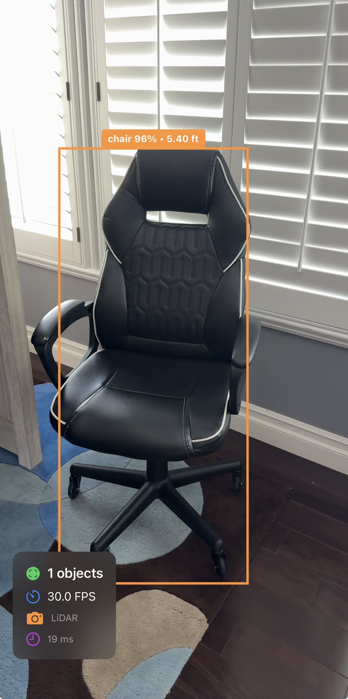
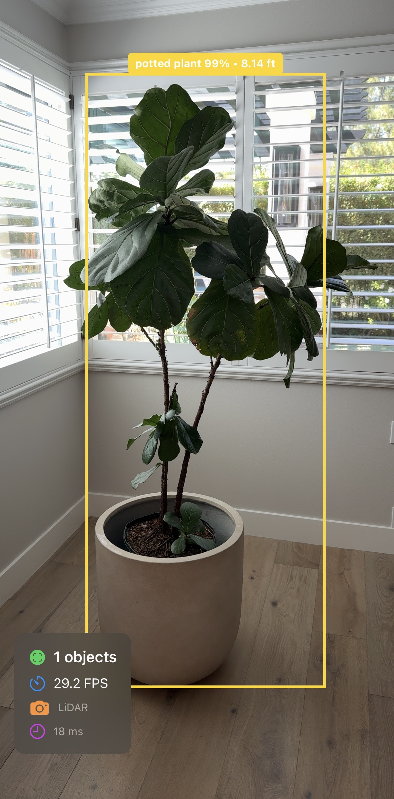

# LiDARVision: Real-Time YOLO + LiDAR Vision Assistance for iPhone

LiDARVision is an iOS research prototype that combines **YOLO-based real-time object detection** with **Apple iPhone depth sensing / LiDAR capabilities** to provide spatially aware assistance for people with visual impairments.

The application uses the iPhone camera feed to detect everyday objects and augments each detection with an estimated distance using **ARKit scene depth** when available. It then overlays those detections on screen and can provide **spoken feedback** so a user can understand what objects are nearby and how far away they are.

## App Preview

<table>
  <tr>
    <td align="center" width="50%">
      
    </td>
    <td align="center" width="50%">
      
    </td>
  </tr>
  <tr>
    <td align="center"><strong>Live object detection with distance readout</strong></td>
    <td align="center"><strong>Depth-aware overlay for larger scene objects</strong></td>
  </tr>
</table>

## Project Goal

The goal of this project is to explore how modern mobile vision models and Apple depth hardware can work together to support **accessible real-time scene understanding**. In particular, the app aims to:

- detect common real-world objects using a YOLO model running on-device
- estimate how far detected objects are from the user using LiDAR / scene depth
- provide spoken feedback for the most relevant nearby detections
- create a foundation for assistive navigation and environmental awareness tools

## What the Code Does

From the repository code, the app currently implements the following pipeline:

1. **Starts an ARKit world-tracking session** using `ARWorldTrackingConfiguration`
2. **Requests scene depth / smoothed scene depth** when supported on the device
3. **Captures camera frames** from the AR session
4. **Runs YOLO inference through Core ML + Vision** using `VNCoreMLRequest`
5. **Builds `Detection` objects** containing label, confidence, bounding box, and optional distance
6. **Stabilizes detections across frames** with a lightweight tracker to reduce flicker
7. **Displays the live camera feed** with bounding boxes and labels in SwiftUI
8. **Announces nearby detections with speech** using `AVSpeechSynthesizer`

## Key Features

- **On-device object detection** using a YOLO Core ML model
- **Depth-aware distance estimation** using ARKit scene depth and LiDAR-capable devices
- **Real-time camera overlay** with bounding boxes, class labels, confidence, and distance
- **Audio feedback** for nearby objects, ordered by proximity
- **Detection smoothing / temporal stabilization** to improve usability
- **Performance-aware processing** with frame skipping and reusable pixel buffers
- **Fallback behavior** on devices without LiDAR, with the UI indicating whether LiDAR or stereo depth is being used

## Main Components

### `ContentView.swift`
Handles camera permission flow and presents the live camera interface.

### `CameraManager.swift`
This is the core runtime controller. It:
- configures and runs the AR session
- checks for LiDAR / scene depth availability
- manages capture, detection, rendering, and speech timing
- tracks FPS and active detections

### `YOLODetector.swift`
Loads the YOLO Core ML model and performs inference with Vision. It maps outputs to COCO labels and returns detection results.

### `Detection.swift`
Defines the app’s detection model, including label, confidence, bounding box, and optional distance in meters.

### `DetectionTracker.swift`
Adds temporal smoothing to reduce noisy bounding boxes and short-lived flicker between frames.

### `DetectionSpeechManager.swift`
Generates spoken summaries such as object names and distances so the app can provide accessible feedback.

### `CameraView.swift`
Displays the camera image and draws detection overlays in SwiftUI.

## Repository Structure

```text
ObjectDetectionApp/
├── ObjectDetectionApp/
│   ├── Camera/
│   │   └── CameraManager.swift
│   ├── Detection/
│   │   ├── Detection.swift
│   │   ├── DetectionSpeechManager.swift
│   │   ├── DetectionTracker.swift
│   │   └── YOLODetector.swift
│   ├── Views/
│   │   └── CameraView.swift
│   ├── ContentView.swift
│   ├── Info.plist
│   └── ObjectDetectionAppApp.swift
└── ObjectDetectionApp.xcodeproj/
```

## Requirements

- iPhone or iPad capable of running the app
- Best experience on a **LiDAR-capable iPhone/iPad Pro**
- Xcode with iOS SDK support
- A converted **YOLO Core ML model** bundled into the app (`yolo11n.mlpackage` / compiled model)

## Model Note

The repository code expects a compiled Core ML model named:

- `yolo11n.mlmodelc`

If the model is missing, the app logs a warning and detection will not run until the model is added.

## Accessibility Value

This project is especially meaningful as an accessibility prototype because it combines:

- **semantic understanding** — what is in the scene
- **spatial understanding** — how far away it is
- **auditory output** — how to communicate that information without requiring vision

Together, those capabilities make the app a strong foundation for assistive perception tools for people with visual impairment.

## Current Limitations

Based on the code currently in the repository:

- the Core ML YOLO model file is expected but may not yet be included
- navigation guidance is not implemented yet
- spoken output is intentionally throttled and only announces a limited number of detections
- detection quality depends on the YOLO model and on-device performance
- depth estimation availability depends on hardware support

## Future Improvements

Potential next steps for the project include:

- obstacle prioritization and path guidance
- directional audio cues (left / center / right)
- custom-trained models for assistive use cases
- user-configurable speech frequency and confidence thresholds
- haptic feedback for urgent nearby obstacles
- detection history and scene summarization

## Research Artifact

The repository also includes the final report:

- `Research.pdf`

This document can be used to understand the research motivation, implementation details, and project outcomes.

## Summary

This repository contains an iOS SwiftUI application that explores a compelling accessibility idea: **using YOLO object detection together with Apple LiDAR / depth sensing to describe the world around a user in real time**. It is a strong prototype for assistive computer vision on mobile devices.

---

If you are opening this project in Xcode, start with `CameraManager.swift` and `YOLODetector.swift` to understand the sensing + inference pipeline.
